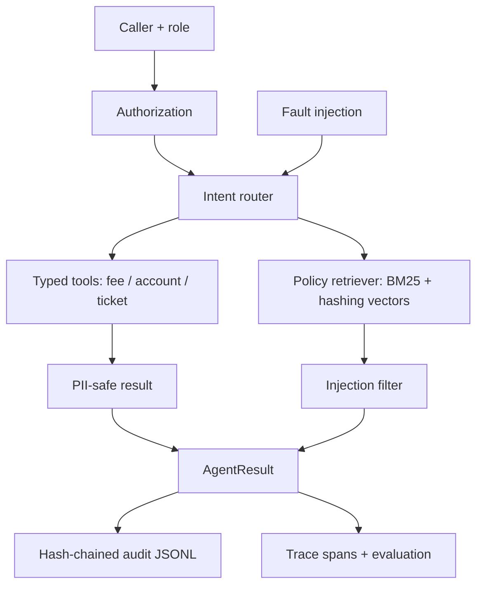

# Architecture

## Request lifecycle
Every request creates a root trace and child spans for authorization, execution and audit. Authorization occurs before a tool side effect. Policy retrieval excludes superseded documents by default and treats retrieved text as data. Typed tools validate account identifiers, quantities, fee types, plans, priorities and reason lengths. User-visible text is PII-redacted. Audit entries include a monotonically increasing sequence and SHA-256 link to the previous entry.

## Retrieval design
Section chunks preserve policy structure; hybrid BM25 plus hashing-embedding rank fusion balances exact terms and token overlap. The default retriever is the kit's deterministic BM25 implementation; the capstone index supports hybrid, BM25 and dense modes for experiments. The 2023 fee schedule is marked superseded and filtered by default.

## Trade-offs
No hosted LLM, API key or vector database is required. The deterministic model makes grading reproducible but does not represent generative-model quality. Regex-based injection and PII defenses are explainable but require ongoing red-team testing. In-memory backends and local JSONL logs are suitable for a laptop demo only.
